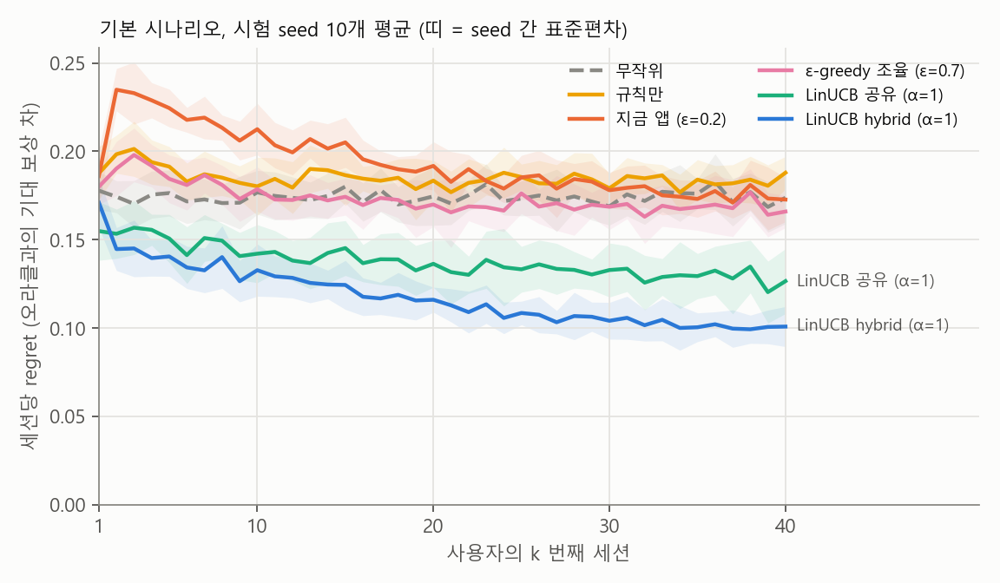
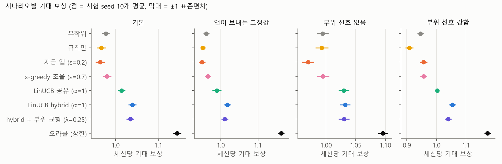
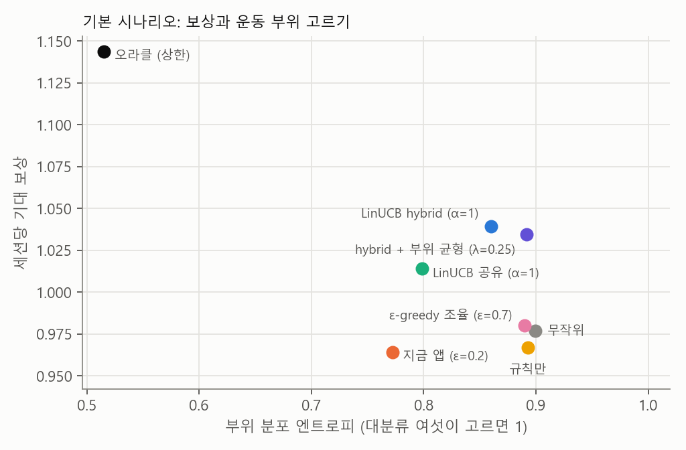
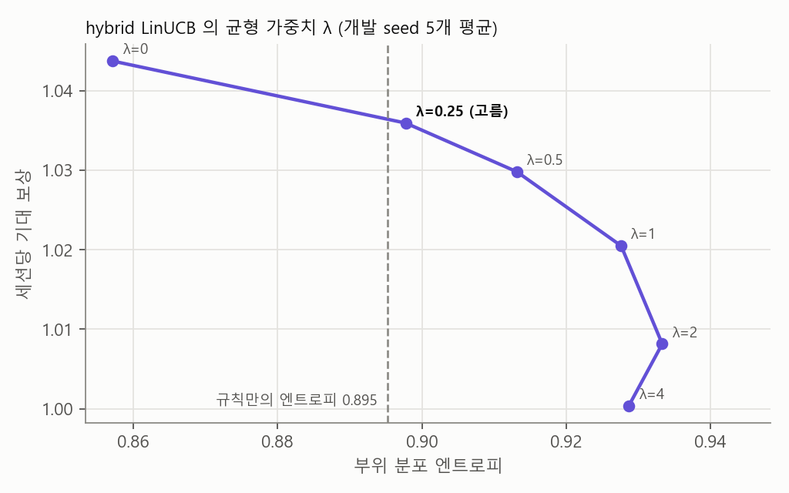

# 추천 방식 시뮬레이션 비교

이 앱은 사용자가 운동을 끝낼 때마다 보상(완료 여부, 체감 난이도, 통증, 연속 운동일로 매긴 점수)을 받아 다음 추천에 반영한다. 이 문서는 그 추천 방식이 실제로 보상을 올리는지를 가상 사용자로 잰 결과다. 실제 사용자 실험은 하지 않았다. 아래 숫자는 모두 4절의 시뮬레이터 가정 아래에서 나온 값이다. 이 결과로 앱의 추천 엔진을 바꾼 내용은 8절에 있다.

## 요약

- **지금 앱의 방식(ε-greedy, ε=0.2)은 무작위 추천보다 세션당 기대 보상이 0.013 낮았다**(기본 시나리오, 시험 seed 10개 가운데 10개에서 낮음). 안 해 본 운동은 0점에서 시작하는데 보상은 세션의 91.7% 에서 양수라서, 한 번 해 본 운동이 계속 이긴다(6.5절).
- **hybrid LinUCB**(모든 사용자가 함께 배우는 모형 + 사용자마다 작은 모형)가 오라클을 뺀 방식 가운데 기대 보상이 가장 높았다. 기본 시나리오에서 지금 방식보다 +0.075, 무작위보다 +0.062 이고, 무작위와 오라클 사이 간격의 37.4% 를 메웠다. 네 시나리오 모두에서 지금 방식·무작위보다 10개 seed 전부 높았다.
- 사용자의 첫 다섯 세션에서도 hybrid LinUCB 의 regret 은 0.148 로 무작위(0.175)·지금 방식(0.221)보다 낮았다. 다른 사용자에게서 배운 공유 모형 덕이다.
- 앱이 실제로 보내는 고정값(피로도 2, 가용 시간 60분)으로 돌리면 hybrid LinUCB 의 regret 이 0.108 에서 0.152 로 올랐다. 조건을 입력받는 화면이 추천 방식 교체만큼 필요하다.
- 보상만 최대로 하는 오라클은 운동 부위 분포 엔트로피가 0.515 로 가장 치우쳤다. 지금 보상 정의에는 부위 균형이 들어 있지 않다. 그래서 hybrid LinUCB 의 점수에 부위 우선순위 점수를 가중치 λ 로 더했고, 개발 seed 에서 「규칙만」만큼 고르게 되는 가장 작은 λ = 0.25 를 골랐다. 시험 seed 에서 hybrid 보다 기대 보상이 0.005 낮고(10개 가운데 9개 낮음) 엔트로피는 0.032 높았다(10/10). 엔트로피는 규칙만과 -0.001 ± 0.006 차이로 seed 간 표준편차 안이고, 기대 보상은 규칙만보다 0.068 높다(10/10).
- **앱에는 hybrid LinUCB(α = 1) + 부위 균형(λ = 0.25)을 넣었고, 추천 화면에서 피로도와 가용 시간을 입력받게 했다**(8절).

## 1. 묻는 것

1. 지금 앱의 추천 방식은 무작위로 고르는 것보다 보상이 높은가.
2. 다른 사용자의 기록을 함께 쓰는 문맥 밴딧(LinUCB)으로 바꾸면 얼마나 올라가는가. 처음 쓰는 사용자에게도 그런가.
3. 그 차이는 시뮬레이터 가정(사용자의 부위 선호 세기, 앱이 보내는 입력값)을 바꿔도 같은 방향인가.

## 2. 용어

| 용어 | 뜻 |
|---|---|
| 세션 | 사용자가 운동하는 날 한 번 추천을 받고 결과를 남기는 것 |
| 후보 | 그 세션에 앱의 후보 생성 규칙(장소, 장비, 부상·통증, 숙련도·피로도별 허용 강도, 가용 시간)을 통과한 운동들. 기본 시나리오 seed 0 무작위 실행에서 세션당 평균 19.7개 |
| 보상 | 앱의 `calculate_reward` 값. 완료 +1, 체감 난이도(RPE, 1에서 10) 6 이상 8 이하 +0.5, 9 초과 -0.5, 통증 -1, 연속 운동일 $s$ 에 $0.1 \ln(1+s)$ |
| 기대 보상 | 같은 날 같은 후보를 무한히 다시 했을 때 보상의 평균. 숨은 속성을 아는 시뮬레이터만 계산할 수 있다. 실현된 보상보다 흩어짐이 작아 비교에 쓴다 |
| 오라클 | 숨은 속성을 알고 그 세션 후보 가운데 기대 보상이 가장 큰 것을 고르는 기준선. 그날만 보고 고르므로 다음 날 피로도에 미치는 영향은 따지지 않는다 |
| regret | 그 세션 오라클의 기대 보상 - 고른 운동의 기대 보상. 0 이면 오라클과 같다 |
| 부위 우선순위 점수 | 앱의 후보 생성이 운동마다 매기는 점수(`priority_score`). 최근 7일 덜 한 대분류일수록 10에서 60, 덜 한 세부 근육이면 +10 또는 +20, 통증 부위에 간접으로 걸리면 -30 |
| 부위 분포 엔트로피 | 사용자별로 받은 운동의 대분류 부위(하체, 가슴, 등 등) 분포의 엔트로피를 $\ln 6$ 으로 나눈 값. 여섯 대분류를 고르게 받으면 1, 한 부위만 받으면 0. 세션 10번 이상인 사용자 평균 |

## 3. 비교한 방식

| 방식 | 고르는 법 | 배우는 것 |
|---|---|---|
| 무작위 | 후보 가운데 아무거나 | 없음 |
| 규칙만 | 앱의 손 규칙 점수(최근 덜 한 부위 가산점 × 0.01, 피로도·시간·순응도 가산점)가 가장 큰 것 | 없음 |
| 지금 앱 (ε=0.2) | 확률 0.2 로 무작위, 나머지는 (그 사용자의 그 운동 보상 평균 + 손 규칙 점수)가 가장 큰 것. 안 해 본 운동의 평균은 0 | 사용자별·운동별 보상 평균 |
| ε-greedy 조율 | 위와 같고 ε 만 개발 seed 로 고른 값(0.7) | 같음 |
| LinUCB 공유 | 문맥 특징(숙련도, 피로도, 가용 시간, 최근 순응도)과 운동 특징(강도, 부위, 스트레칭 여부, 시간, 손 규칙 점수, 최근 두 세션 안 반복 여부)의 곱 105차원에 대한 선형 모형 하나를 모든 사용자가 함께 배운다. 점수 = 예측 + α × 불확실성 | 공유 모형 |
| LinUCB hybrid | 공유 모형에 사용자마다 운동 강도·부위 11차원 모형을 더한다 | 공유 모형 + 사용자별 모형 |
| hybrid + 부위 균형 | hybrid 점수에 λ × (부위 우선순위 점수 / 100) 을 더한다. λ 는 고정값이고 배우지 않는다 | hybrid 와 같음 |
| 오라클 | 2절 | 해당 없음 |

LinUCB 는 Li et al., "A Contextual-Bandit Approach to Personalized News Article Recommendation", WWW 2010 의 알고리즘 1(공유)과 알고리즘 2(hybrid)다. 원 논문에서 기사마다 두는 몫을 여기서는 사용자마다 둔다. hybrid 의 점수는

$$
p = z^\top \hat\beta + x^\top \hat\theta_u + \alpha \sqrt{s}, \qquad
s = z^\top A_0^{-1} z - 2 z^\top A_0^{-1} B_u^\top A_u^{-1} x + x^\top A_u^{-1} x + x^\top A_u^{-1} B_u A_0^{-1} B_u^\top A_u^{-1} x
$$

이고 $z$ 는 공유 특징, $x$ 는 사용자 특징이다. 이 계산이 $[z; x]$ 를 이어 붙인 능형 회귀 한 번과 같은 예측·분산을 내는지 `tests/test_sim.py` 에서 확인했다(차 $10^{-8}$ 이하).

## 4. 시뮬레이터 가정

**앱 코드를 그대로 부르는 부분.** 후보 생성(`build_candidates`), 지금 방식의 선택(`select_action`), 보상 계산(`calculate_reward`), 최근 7일 부위 사용량과 최근 7일 통증 부위로 후보를 거르는 규칙, 연속 운동일 계산. 시뮬레이터가 쓸 수 있도록 앞의 둘을 DB 없는 함수로 떼어 냈고, 떼기 전 코드와 무작위 상태 3,000개에서 후보 목록과 선택이 모두 같았다.

**시뮬레이터만 정하는 부분.** 앱이 볼 수 없는 사용자의 숨은 속성과 결과 모형이다. 결과는 이 값들에 기대고 있다.

| 항목 | 값 |
|---|---|
| 사용자 | seed 마다 200명. 0일에서 59일 사이 아무 날 가입, 120일까지 |
| 신고 숙련도 | 초급 0.4, 중급 0.4, 상급 0.2 |
| 실제 체력 $c$ | 신고 숙련도(0, 1, 2) + N(0, 0.5) |
| 부위 선호 | 대분류마다 N(0, σ²), 기본 σ = 0.8 |
| 부상 | 0.2 확률로 하나 신고(후보에서 빠진다), 0.35 확률로 신고 안 한 약한 관절 하나 |
| 운동하는 날 | 날마다 (주당 가능 일수 3에서 6) / 7 확률 |
| 그날 피로도 | 0에서 5를 0.10, 0.25, 0.30, 0.20, 0.10, 0.05 로. 전날 $d > 0.5$ 인 운동을 끝냈으면 +1 |
| 가용 시간 | 10, 15, 20, 30, 45, 60분을 0.10, 0.15, 0.20, 0.25, 0.15, 0.15 로 |
| 난이도 $d$ | 강도(저 0, 중 1, 고 2) - $c$ + 0.35 × (피로도 - 2) + 0.8 × ln(앱이 조정한 세트 / 원래 세트) |
| 완료 확률 | sigmoid(1.5 + 0.8 × 그 부위 선호 - 1.4 × max(d, 0) - 0.6 × [최근 두 세션에 같은 운동] - 2.0 × [운동 시간 > 가용 시간]) |
| RPE | 6.5 + 1.5 d + N(0, 0.8), 못 끝내면 +0.8, 1에서 10으로 자른다 |
| 통증 확률 | 0.02 + 0.30 × [약한 관절이 그 운동의 금기 관절] + 0.04 × max(d, 0). 통증이 나면 그 관절을 신고하고 앱은 7일 동안 그 관절 운동을 뺀다 |

정책이 바뀌어도 같은 (seed, 사용자, 날) 에는 같은 숨은 속성·그날 조건·결과 난수가 나오게 했다(공통 난수). 그래서 아래 짝 비교의 흩어짐은 방식 차이에서 온 것만 남는다.

## 5. 실험 설계

- **조율**: 개발 seed 0에서 4, 기본 시나리오. ε ∈ {0.05, 0.1, 0.2, 0.3, 0.5, 0.7}, 공유 α ∈ {0.1, 0.3, 1, 3}, hybrid α ∈ {0.1, 0.3, 1, 3} 가운데 세션당 기대 보상 평균이 가장 큰 값. 결과는 ε = 0.7, 공유 α = 1, hybrid α = 1. 처음 격자(ε 0.3 까지, α 1 까지)에서 끝값이 뽑혀 바깥으로 넓혔다. α 는 3 에서 다시 내려갔다. ε 는 0.7 까지 계속 올랐는데, ε = 1 은 무작위 방식과 같으므로 ε-greedy 의 상한은 무작위 줄에서 읽는다.
- **균형 가중치**: 고른 hybrid(α = 1)에 λ ∈ {0, 0.25, 0.5, 1, 2, 4} 를 개발 seed 0에서 4로 돌렸다. 고르는 규칙은 결과를 보기 전에 정했다. 부위 엔트로피가 같은 seed 의 「규칙만」 이상인 λ 가운데 가장 작은 것. 앱의 손 규칙만큼은 고르게 하면서 보상을 가장 덜 내주는 값이다. 결과는 6.6절.
- **본 실험**: 시험 seed 100에서 109(조율에 안 쓴 seed). 네 시나리오 × 여덟 방식 × 10 seed = 320번. seed 하나에 세션 평균 11,529번.
- **시나리오**: 기본 / 앱이 보내는 고정값(피로도 2, 가용 시간 60분, 순응도 0.8 을 보낸다. 실제 피로도·가용 시간은 기본과 같이 변한다) / 부위 선호 없음(σ = 0) / 부위 선호 강함(σ = 1.5).

| 조율 (개발 seed 5개 평균 기대 보상) | 0.05 | 0.1 | 0.2 | 0.3 | 0.5 | 0.7 | 1 | 3 |
|---|---|---|---|---|---|---|---|---|
| ε-greedy (ε) | 0.941 | 0.952 | 0.967 | 0.976 | 0.981 | **0.983** | | |
| LinUCB 공유 (α) | | 0.985 | | 1.010 | | | **1.012** | 1.009 |
| LinUCB hybrid (α) | | 1.031 | | 1.041 | | | **1.044** | 1.027 |

## 6. 결과

### 6.1 기본 시나리오

시험 seed 10개 평균. 괄호는 seed 간 표준편차.

| 방식 | 기대 보상 | regret | 완료율 | 통증률 | RPE 6에서 8 비율 | 부위 엔트로피 | 가장 많이 받은 운동 비율 |
|---|---|---|---|---|---|---|---|
| 무작위 | 0.977 (0.009) | 0.174 | 0.770 | 0.039 | 0.322 | 0.899 | 0.135 |
| 규칙만 | 0.967 (0.011) | 0.184 | 0.768 | 0.038 | 0.306 | 0.893 | 0.154 |
| 지금 앱 (ε=0.2) | 0.964 (0.011) | 0.185 | 0.755 | 0.033 | 0.318 | 0.772 | 0.311 |
| ε-greedy 조율 (ε=0.7) | 0.980 (0.010) | 0.170 | 0.769 | 0.037 | 0.326 | 0.890 | 0.153 |
| LinUCB 공유 (α=1) | 1.014 (0.008) | 0.133 | 0.769 | 0.038 | 0.398 | 0.799 | 0.225 |
| **LinUCB hybrid (α=1)** | **1.039 (0.009)** | **0.108** | 0.793 | 0.036 | 0.387 | 0.860 | 0.219 |
| hybrid + 부위 균형 (λ=0.25) | 1.034 (0.009) | 0.114 | 0.791 | 0.037 | 0.384 | 0.892 | 0.199 |
| 오라클 | 1.144 (0.009) | 0 | 0.844 | 0.024 | 0.451 | 0.515 | 0.331 |

「가장 많이 받은 운동 비율」은 사용자별로 가장 자주 받은 운동 하나가 그 사용자 세션에서 차지하는 비율의 평균이다.

### 6.2 짝 비교

같은 seed 끼리 뺀 차의 평균 ± seed 간 표준편차, 괄호는 앞 방식이 높았던 seed 수(10개 중).

| 기대 보상 차 | 기본 | 앱 고정값 | 선호 없음 | 선호 강함 |
|---|---|---|---|---|
| hybrid - 지금 앱 | +0.075 ± 0.005 (10) | +0.068 ± 0.003 (10) | +0.062 ± 0.006 (10) | +0.097 ± 0.005 (10) |
| hybrid - 무작위 | +0.062 ± 0.004 (10) | +0.056 ± 0.003 (10) | +0.038 ± 0.005 (10) | +0.108 ± 0.004 (10) |
| hybrid - 공유 | +0.025 ± 0.004 (10) | +0.028 ± 0.007 (10) | +0.002 ± 0.005 (8) | +0.051 ± 0.009 (10) |
| 지금 앱 - 무작위 | -0.013 ± 0.004 (0) | -0.011 ± 0.003 (0) | -0.025 ± 0.002 (0) | +0.011 ± 0.004 (10) |
| 규칙만 - 무작위 | -0.010 ± 0.003 (0) | -0.010 ± 0.004 (0) | -0.001 ± 0.002 (1) | -0.037 ± 0.005 (0) |
| 균형 - hybrid | -0.005 ± 0.003 (1) | -0.007 ± 0.004 (0) | -0.002 ± 0.003 (3) | -0.014 ± 0.005 (0) |
| 균형 - 지금 앱 | +0.070 ± 0.005 (10) | +0.061 ± 0.002 (10) | +0.061 ± 0.004 (10) | +0.083 ± 0.006 (10) |

「균형」은 hybrid + 부위 균형(λ = 0.25)이다.

무작위와 오라클 사이 간격 가운데 메운 몫 = (방식 - 무작위) / (오라클 - 무작위):

| | 기본 | 앱 고정값 | 선호 없음 | 선호 강함 |
|---|---|---|---|---|
| 지금 앱 | -7.7% | -5.7% | -24.4% | +4.7% |
| LinUCB 공유 | 22.2% | 14.0% | 35.1% | 24.9% |
| LinUCB hybrid | 37.4% | 28.0% | 37.3% | 47.4% |
| hybrid + 부위 균형 | 34.4% | 24.6% | 35.6% | 41.3% |

사용자별 모형이 더하는 몫(hybrid - 공유)은 부위 선호가 없으면 +0.002(8/10)로 seed 간 표준편차 0.005 안이고, 선호가 강하면 +0.051 이다. 사용자별 모형은 시뮬레이터에 넣은 개인 선호를 잡는 데 쓰이고 있다.

### 6.3 처음 쓰는 사용자



가로축은 사용자의 몇 번째 세션인지, 세로축은 그 세션 regret 의 평균이다. 사용자가 0일에서 59일 사이에 가입하므로 늦게 가입한 사용자의 첫 세션에는 이미 다른 사용자의 기록이 쌓여 있다.

| 첫 다섯 세션 regret | 기본 | 앱 고정값 | 선호 없음 | 선호 강함 |
|---|---|---|---|---|
| 무작위 | 0.175 | 0.212 | 0.103 | 0.229 |
| 지금 앱 | 0.221 | 0.256 | 0.154 | 0.271 |
| LinUCB 공유 | 0.154 | 0.210 | 0.084 | 0.205 |
| LinUCB hybrid | 0.148 | 0.200 | 0.082 | 0.199 |
| hybrid + 부위 균형 | 0.150 | 0.204 | 0.081 | 0.202 |

지금 방식은 첫 다섯 세션에서 무작위보다 regret 이 0.047 높다(10/10). 처음 고른 운동의 보상이 양수면 그 운동이 다른 0점 운동을 계속 이기기 때문이다. 두 LinUCB 는 첫 세션부터 공유 모형으로 고르므로 무작위보다 낮다(기본 시나리오 hybrid 0/10 seed 에서 무작위보다 높음).

### 6.4 시나리오별



네 시나리오에서 방식의 순서(hybrid, hybrid + 부위 균형 > 공유 > 무작위·ε-greedy·규칙)는 같았다. 부위 선호가 없을 때만 hybrid + 부위 균형과 공유의 차가 +0.001(5/10)로 갈리지 않았다. 앱 고정값 시나리오에서는 정책이 실제 피로도와 가용 시간을 모르므로 모든 학습 방식의 regret 이 올랐다(hybrid 0.108 → 0.152, 공유 0.133 → 0.182). 후보 생성도 60분을 기준으로 하므로 가용 시간보다 긴 운동이 후보에 남는다.

### 6.5 지금 방식이 무작위보다 낮은 이유

`python -m sim.diagnose_lockin` 으로 기본 시나리오 시험 seed 100, 101, 102 에서 잰 값이다.

| seed | 보상 > 0 인 세션 비율 | 활용 선택 가운데 이미 해 본 운동 | 그때 안 해 본 후보가 있었던 비율 |
|---|---|---|---|
| 100 | 0.917 | 0.951 | 0.925 |
| 101 | 0.921 | 0.956 | 0.918 |
| 102 | 0.919 | 0.950 | 0.917 |

보상이 양수인 세션이 91.7% 이상이다. 해 본 운동의 보상 평균이 양수이면, 두 운동의 손 규칙 점수 차가 그 평균보다 작은 한 안 해 본 운동(시작값 0)을 이긴다. 그래서 무작위가 아닌 선택(활용)의 95% 이상이 이미 해 본 운동으로 가고, 그 선택의 91.7%에서 92.5%는 안 해 본 후보가 있는데도 그랬다. 가장 많이 받은 운동 비율이 0.311 로 무작위(0.135)의 2.3배인 것도 같은 현상이다. ε 를 키우면 이 묶임이 풀리지만(조율 ε = 0.7) 그만큼 무작위에 가까워질 뿐 무작위보다 0.003 높은 데서 그친다.

### 6.6 보상과 부위 고르기



오라클은 보상이 가장 높지만 엔트로피가 0.515 로 가장 치우쳤다. 지금 보상 정의에 부위 균형이 없으므로, 보상만 올리면 그 사용자가 잘 끝내는 부위로 몰린다. hybrid LinUCB 는 0.860 으로 무작위(0.899)보다 0.039 낮고 지금 방식(0.772)보다 0.088 높다. hybrid 에서 부위 우선순위 점수는 특징 하나로 들어가 있을 뿐이어서 균형을 지키라는 몫은 없다.

그래서 균형을 보상에 섞지 않고 고를 때 따로 더했다. 점수 = hybrid 점수 + λ × (부위 우선순위 점수 / 100). 보상에 섞으면 모형이 균형 점수까지 배워야 하는데, 이 점수는 기록에서 바로 계산되므로 배울 필요가 없다. 보상은 사용자 결과(완료, 난이도, 통증)만 재는 값으로 남는다.



개발 seed 5개 평균이다. λ 를 키우면 기대 보상은 1.044 에서 1.000 까지 내려가고 엔트로피는 0.857 에서 λ = 2 의 0.933 까지 오른 뒤 λ = 4 에서 0.929 로 내려갔다. 규칙만의 엔트로피 0.895 를 넘는 가장 작은 값이 λ = 0.25(0.898)여서 이것을 골랐다.

시험 seed 에서 hybrid + 부위 균형은 hybrid 대비 기대 보상 -0.005 ± 0.003(10개 가운데 1개만 높음), 엔트로피 +0.032 ± 0.006(10/10), 가장 많이 받은 운동 비율 -0.019(0.219 → 0.199)였다. 엔트로피 0.892 는 규칙만 0.893 과 -0.001 ± 0.006(4/10) 차이로, 개발 seed 에서 정한 「규칙만 이상」을 시험 seed 에서는 seed 간 표준편차 안에서 맞췄다. 기대 보상은 규칙만보다 +0.068 ± 0.004(10/10), 지금 방식보다 +0.070 ± 0.005(10/10) 높다.

## 7. 이 결과가 말하지 않는 것

- **실제 사용자에게서 같은 차이가 난다는 것.** 순서와 크기는 4절의 결과 모형에 기대고 있다. 특히 완료·RPE 가 강도와 체력의 차 $d$ 로 정해진다는 가정은 LinUCB 가 쓰는 강도 특징과 맞물린다. 결과 모형을 비선형으로 두었지만(시그모이드, RPE 구간 보상) 다른 형태의 사용자 모형에서는 재지 않았다.
- **사용자가 떠나는 효과.** 운동하는 날은 정책과 무관하게 정했다. 추천이 나쁘면 앱을 덜 쓰는 효과는 없다.
- **며칠에 걸친 계획.** 오라클도 그날만 본다. 피로 누적을 내다보는 방식은 비교하지 않았다.
- **통증.** hybrid 의 통증률 0.036 은 지금 방식 0.033 보다 0.002 높았고(10/10) 무작위보다 0.003 낮았다. hybrid + 부위 균형은 0.037 로 지금 방식보다 0.003 높았다(10/10). 통증 벌점 -1 이 보상 안에 있지만, 통증을 따로 제약하는 방식은 재지 않았다.
- **하이퍼파라미터 밖.** 능형 회귀의 규제 계수는 1 로 고정했고 특징 구성은 한 가지만 썼다. 균형 가중치는 α = 1 에서만 훑었다.
- **숙련도 승급.** 앱은 완료 15번에 초급에서 중급, 40번에 중급에서 상급으로 신고 숙련도를 올린다(`progression_service`). 시뮬레이터는 숙련도를 고정했다. 승급하면 허용 강도가 넓어져 후보가 바뀐다.
- **사용자 수.** 공유 모형은 seed 마다 200명이 120일 동안 쌓은 세션 약 11,500번으로 배운다. 사용자가 적은 실제 앱에서는 공유 모형이 배울 기록이 그보다 적다.

## 8. 앱에 반영한 것

1. **추천 엔진을 hybrid LinUCB(α = 1) + 부위 균형(λ = 0.25)으로 바꿨다.** 계산은 `app/services/linucb.py` 하나를 앱과 시뮬레이터가 함께 쓴다. 공유 몫은 `linucb_shared` 표 한 행, 사용자별 몫은 `linucb_users` 표에 둔다. 추천 때 쓴 state(최근 두 세션의 운동 포함)를 추천 기록에 저장해 두고, 보상이 오면 같은 특징을 다시 만들어 갱신한다. 예전 방식의 사용자별 보상 평균(`bandit_stats`)도 계속 쌓으므로 `RECOMMENDER=eps_greedy` 로 되돌릴 수 있다. 설정은 `app/core/config.py` 의 `RECOMMENDER`·`LINUCB_ALPHA`·`BALANCE_WEIGHT`.
2. **추천 화면에서 피로도(0에서 5)와 운동할 수 있는 시간(10에서 60분)을 고르게 했다.** 바꾸면 추천을 다시 받는다. 최근 7일 순응도와 평균 RPE 는 프런트가 보내던 고정값(0.8, 5.0) 대신 서버가 기록으로 계산한다.
3. **부위 균형을 목표로 넣었다.** 6.6절.

앱 쪽 확인은 `tests/test_api_flow.py` 다. 온보딩, 추천, 로그, 보상을 SQLite 로 돌려, 보상 한 번 뒤 DB 에 저장된 모형이 같은 특징으로 직접 갱신한 모형과 같은지 본다. 공유 모형은 빈 상태에서 시작한다. 시뮬레이터의 모형을 옮겨 오면 시뮬레이터 가정까지 옮겨 오게 되므로 쓰지 않았다.

> 처음 판(2026-11-18)의 다음 단계: (1) 엔진을 hybrid LinUCB(α = 1)로 바꾼다 (2) 피로도·가용 시간을 입력받는다 (3) 부위 균형을 목표로 둘지 정한다. 셋 다 위와 같이 반영했다.

## 재현

```bash
python -m pytest tests                 # 기대 보상 대 몬테카를로, hybrid 대 능형 회귀, 후보 규칙, API 흐름
python -m sim.run_experiments          # 조율 70번 + 균형 35번 + 본 실험 320번, 16코어에서 약 12분
python -m sim.plot_results             # docs/figures/sim_*.png
python -m sim.diagnose_lockin 100      # 6.5절
```

파일: 시뮬레이터 `sim/simulator.py`, 방식 `sim/policies.py`, 실험 `sim/run_experiments.py`, 결과 CSV `sim/results/`(`tuning.csv` 조율, `balance.csv` 균형 가중치, `runs.csv` 실행마다 한 줄, `curves.csv` k 번째 세션 곡선, `tuned.csv` 고른 값), 그림 `docs/figures/`.
